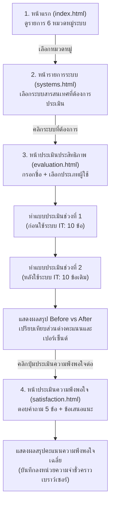

# คู่มือและบทวิเคราะห์ระบบ IT Evaluator
*(ระบบประเมินประสิทธิภาพและประสิทธิผลของระบบ IT — คณะสหเวชศาสตร์ มหาวิทยาลัยนเรศวร)*

---

## 1. โปรเจกต์นี้คืออะไร

**IT Evaluator** คือ เว็บแอปพลิเคชันสำหรับสำรวจและประเมินผลการใช้งานระบบสารสนเทศ (IT Systems) ต่าง ๆ ภายในคณะสหเวชศาสตร์ มหาวิทยาลัยนเรศวร เพื่อวัดผลว่าระบบ IT แต่ละระบบที่นำมาใช้งานนั้น ช่วยเพิ่มประสิทธิภาพในการทำงานจริงมากน้อยเพียงใดเมื่อเทียบกับวิธีการทำงานแบบเดิม

* **เปรียบเทียบให้เห็นภาพ:** 
  เหมือนกับ "แบบสำรวจสุขภาพและความคุ้มค่าของเครื่องมือ" หากเปรียบระบบ IT เหมือนเครื่องซักผ้าที่ซื้อมาใหม่ ระบบนี้จะเป็นแบบประเมินที่ถามผู้ใช้งานว่า *“เมื่อก่อนซักมือใช้เวลากี่นาที เหนื่อยแค่ไหน”* เทียบกับ *“พอใช้เครื่องซักผ้าแล้ว งานเสร็จไวขึ้นและสบายขึ้นเท่าไหร่”* พร้อมถามต่อว่า *“พึงพอใจกับเครื่องนี้แค่ไหน มีจุดไหนที่อยากให้ปรับปรุง”*
* **ปัญหาที่ต้องการแก้ไข:** 
  1. คณะฯ มีระบบ IT ใช้งานเป็นจำนวนมาก แต่ขาดเครื่องมือประเมินผลที่เป็นรูปธรรมในการวัดว่าระบบช่วยลดภาระงาน ลดการใช้กระดาษ หรือเพิ่มความสะดวกรวดเร็วได้จริงหรือไม่
  2. การสำรวจแบบเดิมด้วยกระดาษทำได้ช้าและประมวลผลเปรียบเทียบ Before–After ได้ยาก
* **กลุ่มผู้ใช้งาน:**
  1. **ผู้ทำแบบประเมิน (End Users):** นิสิต, อาจารย์ และบุคลากรสายสนับสนุนของคณะฯ
  2. **ผู้ดูแลระบบ / ผู้บริหาร (Admin & Management):** ใช้ดูรายงานและสถิติเพื่อนำไปปรับปรุงระบบต่อไป (อยู่ระหว่างวางแผนพัฒนา)

---

## 2. ภาพรวมการทำงาน

ขั้นตอนการทำงานของผู้ใช้งาน (User Journey) ในสถานะปัจจุบันของระบบดำเนินไปตามแผนภาพดังนี้:



### ลำดับขั้นตอนอย่างละเอียด:
1. **เลือกหมวดหมู่:** ผู้ใช้เปิดหน้าแรก พบกับ 6 หมวดหมู่งาน (บุคลากร, วิจัย, ภาระงาน, สารบรรณ, ทรัพยากร, การเงิน)
2. **เลือกระบบย่อย:** เลือกระบบที่ตนเองเคยใช้งานจากหมวดหมู่นั้น (รวม 21 ระบบ)
3. **กรอกข้อมูลเบื้องต้น:** ใส่ชื่อผู้ประเมินและเลือกประเภท (นิสิต / อาจารย์ / บุคลากรสายสนับสนุน)
4. **ทำแบบประเมินเปรียบเทียบ (Before & After):**
   * **ช่วงที่ 1 (ก่อนใช้ระบบ):** นึกถึงการทำงานเดิมแล้วให้คะแนน 1–5 ดาว ในคำถาม 10 ข้อ (มีปุ่มกดข้ามหากไม่เคยมีประสบการณ์)
   * **ช่วงที่ 2 (หลังใช้ระบบ):** ประเมินระบบปัจจุบันใน 10 ข้อคำถามเดียวกัน
5. **ดูผลสรุปเบื้องต้น:** ระบบคำนวณคะแนนเฉลี่ยก่อนใช้ เทียบกับหลังใช้ และคิดเป็นผลต่างให้ทันที พร้อมเก็บข้อมูลร่างลงใน `sessionStorage`
6. **ประเมินความพึงพอใจต่อเนื่อง:** ทำแบบประเมินความพึงพอใจ 5 ข้อ และพิมพ์ข้อเสนอแนะเพิ่มเติม (จำกัด 250 ตัวอักษร)
7. **เสร็จสิ้น:** แสดงผลคะแนนความพึงพอใจเฉลี่ย และเก็บผลรวมฉบับสมบูรณ์ไว้ในหน่วยความจำของเบราว์เซอร์

---

## 3. โครงสร้างไฟล์

```text
EffectivenessOfTheSystemVerPunPun/
├── .vscode/                      # การตั้งค่าสำหรับ VS Code (C++ Runner & Debugger)
│   ├── c_cpp_properties.json
│   ├── launch.json
│   └── settings.json
└── evaluator/                    # โฟลเดอร์หลักของโปรเจกต์
    ├── infomation.md             # ไฟล์เอกสารสรุปภาพรวมโปรเจกต์ (ไฟล์นี้)
    ├── requirements.md           # ไฟล์ข้อกำหนดความต้องการ (ปัจจุบันเป็นไฟล์ว่าง)
    │
    ├── database/                 # ส่วนโครงสร้างฐานข้อมูล (ยังว่างเปล่า)
    │   ├── schema.sql            # ไฟล์สคริปต์ตารางข้อมูล (ไฟล์ว่าง)
    │   └── seed.sql              # ไฟล์ข้อมูลจำลองเริ่มต้น (ไฟล์ว่าง)
    │
    ├── backend/                  # ส่วนเซิร์ฟเวอร์หลังบ้านภาษา C++ (ยังว่างเปล่า)
    │   └── src/
    │       ├── main.cpp          # จุดเริ่มต้นรันโปรแกรม (ไฟล์ว่าง)
    │       ├── admin.cpp         # จัดการแอดมิน (ไฟล์ว่าง)
    │       ├── database.cpp      # เชื่อมต่อฐานข้อมูล (ไฟล์ว่าง)
    │       ├── evaluations.cpp   # บันทึก/คำนวณการประเมิน (ไฟล์ว่าง)
    │       ├── satisfaction.cpp  # จัดการความพึงพอใจ (ไฟล์ว่าง)
    │       └── systems.cpp       # จัดการข้อมูลระบบ IT (ไฟล์ว่าง)
    │
    └── frontend/                 # ส่วนหน้าบ้านเว็บแอปพลิเคชัน
        ├── admin/                # หน้าจอสำหรับผู้ดูแลระบบ (ยังไม่เริ่มพัฒนา)
        │   ├── dashboard.html    # หน้าแดชบอร์ดสรุปผล (ไฟล์ว่าง)
        │   ├── evaluation-detail.html # หน้ารายละเอียดการประเมิน (ไฟล์ว่าง)
        │   └── login.html        # หน้าเข้าสู่ระบบแอดมิน (ไฟล์ว่าง)
        │
        ├── assets/               # ทรัพยากรส่วนกลาง
        │   ├── css/
        │   │   ├── common.css       # สไตล์พื้นฐานส่วนกลาง (ฟอนต์, สีพื้นหลัง, คอนเทนเนอร์)
        │   │   ├── gallery.css      # สไตล์การ์ดภาพหมวดหมู่หน้าแรก
        │   │   ├── systems.css      # สไตล์รายการระบบ IT
        │   │   ├── evaluation.css   # สไตล์แบบประเมินและการให้ดาว
        │   │   ├── satisfaction.css # สไตล์แบบประเมินความพึงพอใจ
        │   │   └── dashboard.css    # สไตล์หน้าแดชบอร์ด (ไฟล์ว่าง)
        │   │
        │   ├── images/categories/   # ภาพประกอบประจำ 6 หมวดหมู่ (.jpg)
        │   │   ├── documents.jpg, finance.jpg, personnel.jpg,
        │   │   ├── research.jpg, resources.jpg, workload.jpg
        │   │
        │   └── js/
        │       ├── systems-data.js  # ข้อมูล Mockup หมวดหมู่และ 21 ระบบ IT
        │       ├── gallery.js       # สร้างการ์ดหมวดหมู่ในหน้า index.html
        │       ├── systems.js       # แสดงรายชื่อระบบตามหมวดที่เลือกใน systems.html
        │       ├── evaluation.js    # ควบคุมตรรกะแบบประเมิน Before-After และคำนวณคะแนน
        │       ├── satisfaction.js  # ควบคุมแบบประเมินความพึงพอใจและเก็บข้อมูลสรุป
        │       ├── api.js           # โมดูลเชื่อมต่อ API หลังบ้าน (ไฟล์ว่าง)
        │       └── dashboard.js     # ควบคุมกราฟและตารางแดชบอร์ด (ไฟล์ว่าง)
        │
        └── user/                 # หน้าเว็บสำหรับผู้ใช้งานทั่วไป (พัฒนาเสร็จสมบูรณ์ระดับ UI)
            ├── index.html           # หน้าแรกเลือกหมวดหมู่
            ├── systems.html         # หน้ารายการระบบ IT ภายใต้หมวดหมู่
            ├── evaluation.html      # หน้าแบบประเมินประสิทธิภาพ Before–After
            └── satisfaction.html    # หน้าแบบประเมินความพึงพอใจและส่งข้อเสนอแนะ
```

---

## 4. อธิบายโค้ดสำคัญ

การทำงานทั้งหมดในปัจจุบันขับเคลื่อนด้วย JavaScript ฝั่งหน้าบ้าน (Client-side):

### 4.1 ชุดข้อมูลระบบสารสนเทศ ([systems-data.js](file:///c:/Users/new08/Desktop/GetSomework/ฝึกงาน69/EffectivenessOfTheSystemVerPunPun/evaluator/frontend/assets/js/systems-data.js))
จัดเก็บโครงสร้างหมวดหมู่และระบบ IT ทั้งหมด 21 ระบบในรูปแบบอาร์เรย์ของออบเจกต์ (Array of Objects):
```javascript
const categories = [
    {
        id: "personnel",
        name: "บุคลากรและการปฏิบัติงาน",
        image: "personnel.jpg",
        systems: [
            { id: "SYS001", name: "รายชื่อบุคลากร" },
            { id: "SYS002", name: "ระบบลาออนไลน์" },
            { id: "SYS003", name: "ลงเวลาปฏิบัติงาน" }
        ]
    },
    // ... มีทั้งหมด 6 หมวดหมู่ รวม 21 ระบบ
];
```
* **การทำงาน:** ไฟล์หน้าเว็บอื่น ๆ จะเรียกใช้ตัวแปร `categories` นี้เพื่อดึงชื่อ รหัส และหมวดหมู่ของระบบมาแสดงผล

### 4.2 ระบบส่งต่อข้อมูลผ่าน URL Parameter ([gallery.js](file:///c:/Users/new08/Desktop/GetSomework/ฝึกงาน69/EffectivenessOfTheSystemVerPunPun/evaluator/frontend/assets/js/gallery.js) & [systems.js](file:///c:/Users/new08/Desktop/GetSomework/ฝึกงาน69/EffectivenessOfTheSystemVerPunPun/evaluator/frontend/assets/js/systems.js))
เมื่อผู้ใช้คลิกเลือกการ์ดในหน้าเว็บ ระบบจะส่งต่อรหัสผ่าน URL (Query String):
* จาก `index.html` ส่งไป `systems.html?category=personnel`
* จาก `systems.html` ส่งไป `evaluation.html?system=SYS001`
* ตัวอย่างโค้ดอ่านค่า URL:
  ```javascript
  const params = new URLSearchParams(window.location.search);
  const systemId = params.get("system");
  ```

### 4.3 ระบบแบบประเมินสองช่วง Before–After ([evaluation.js](file:///c:/Users/new08/Desktop/GetSomework/ฝึกงาน69/EffectivenessOfTheSystemVerPunPun/evaluator/frontend/assets/js/evaluation.js))
* **การเก็บคำตอบ:** ใช้ Object แยก 2 ช่วง คำถามละ 10 ข้อ:
  ```javascript
  let answers = {
      before: Array(10).fill(undefined),
      after: Array(10).fill(undefined)
  };
  ```
* **การข้ามข้อที่ประเมินไม่ได้:** หากผู้ใช้กดปุ่มไม่สามารถประเมินได้ ระบบจะบันทึกเป็น `null` ทำให้ไม่นำข้อนั้นมาคิดคะแนน
* **การคิดคะแนนเปรียบเทียบอย่างเป็นธรรม:** ฟังก์ชัน `showResult()` จะจับคู่เปรียบเทียบเฉพาะข้อที่มีคะแนนครบทั้งช่วง Before และ After เท่านั้น:
  ```javascript
  for (let i = 0; i < questions.length; i++) {
      const before = answers.before[i];
      const after = answers.after[i];
      if (typeof before === "number" && typeof after === "number") {
          beforeValues.push(before);
          afterValues.push(after);
      }
  }
  ```

### 4.4 การส่งต่อข้อมูลข้ามหน้าด้วย SessionStorage ([evaluation.js](file:///c:/Users/new08/Desktop/GetSomework/ฝึกงาน69/EffectivenessOfTheSystemVerPunPun/evaluator/frontend/assets/js/evaluation.js) และ [satisfaction.js](file:///c:/Users/new08/Desktop/GetSomework/ฝึกงาน69/EffectivenessOfTheSystemVerPunPun/evaluator/frontend/assets/js/satisfaction.js))
เนื่องจากยังไม่มีระบบฐานข้อมูลจริง ระบบจึงใช้หน่วยความจำชั่วคราวของเบราว์เซอร์ (`sessionStorage`):
1. `evaluation.js` บันทึกผลร่างลงคีย์ `"itEvaluationDraft"`
2. เมื่อผู้ใช้คลิกไปหน้า `satisfaction.html` สคริปต์ `satisfaction.js` จะดึงข้อมูลร่างออกมา ตรวจสอบว่ารหัสระบบตรงกันหรือไม่ แล้วนำคะแนนความพึงพอใจและข้อเสนอแนะมารวมเข้าด้วยกัน ก่อนบันทึกเป็น `"itEvaluationComplete"`

---

## 5. เทคโนโลยีที่ใช้

| หมวดหมู่ | เทคโนโลยี / เครื่องมือ | หน้าที่การทำงาน | เหตุผลที่ใช้ |
| :--- | :--- | :--- | :--- |
| **โครงสร้างเว็บ (Frontend UI)** | **HTML5** | วางโครงสร้างหน้าเว็บแบบ Semantic | เรียบง่าย ไม่ต้องติดตั้งตัวแปลงโค้ด เบราว์เซอร์เปิดได้ทันที |
| **การตกแต่ง (Styling)** | **CSS3** | จัด 레이เอาต์ ฟอนต์ การตอบสนองหน้าจอ และแอนิเมชันดาว | ยืดหยุ่น โค้ดกระชับ โหลดเร็ว |
| **การประมวลผลหน้าเว็บ (Logic)** | **Vanilla JavaScript (ES6+)** | ควบคุมสถานะแบบสอบถาม, คำนวณคะแนน, ควบคุม DOM | ไม่มี Dependency ภายนอก เบา และแก้ไขได้ง่าย |
| **หน่วยความจำชั่วคราว** | **Web Storage (sessionStorage)** | บันทึกผลการประเมินข้ามหน้าเว็บ | ช่วยให้ทดลองใช้งานเวิร์กโฟลว์ได้สมบูรณ์แม้ยังไม่มีหลังบ้าน |
| **เซิร์ฟเวอร์หลังบ้าน (ตามโครงสร้าง)** | **C++ (gcc / g++)** | วางโครงไฟล์ไว้สำหรับทำ REST API / Web Backend | มีการตั้งค่า `.vscode` สำหรับคอมไพล์และดีบัก C++ *(ปัจจุบันไฟล์โค้ดยังว่าง)* |
| **ฐานข้อมูล (ตามโครงสร้าง)** | **SQL (schema.sql / seed.sql)** | วางแผนสำหรับจัดเก็บผลการประเมินระยะยาว | *(ปัจจุบันไฟล์โค้ดยังว่าง)* |

---

## 6. วิธีติดตั้งและรันโปรเจกต์

เนื่องจากส่วนที่พัฒนาเสร็จแล้วเป็น **Static Frontend (HTML/CSS/JS)** ทั้งหมด คุณจึงสามารถทดสอบรันได้ทันทีโดยไม่ต้องติดตั้ง Backend หรือ Database:

### วิธีที่ 1: รันผ่านโปรแกรมเบราว์เซอร์โดยตรง (ง่ายที่สุด)
1. ดับเบิลคลิกเปิดไฟล์:
   ```text
   evaluator/frontend/user/index.html
   ```
2. หน้าเว็บจะเปิดขึ้นบน Google Chrome, Edge หรือเบราว์เซอร์ใดก็ได้ และสามารถคลิกทดสอบได้ครบทุกฟังก์ชันทันที

### วิธีที่ 2: รันผ่าน VS Code Live Server (แนะนำ)
1. เปิดโฟลเดอร์โปรเจกต์ด้วย Visual Studio Code
2. ติดตั้ง Extension ชื่อ **Live Server** (หากยังไม่มี)
3. คลิกขวาที่ไฟล์ `evaluator/frontend/user/index.html` แล้วเลือก **"Open with Live Server"**
4. เบราว์เซอร์จะเปิดที่ที่อยู่ `http://127.0.0.1:5500/evaluator/frontend/user/index.html`

*(หมายเหตุ: ส่วน C++ Backend ยังไม่มีโค้ด จึงยังไม่มีคำสั่งคอมไพล์หรือรันระบบหลังบ้านในขณะนี้)*

---

## 7. ระบบข้อมูลและการเชื่อมต่อ

* **ฐานข้อมูล (Database):** **ไม่พบการเชื่อมต่อจริง** ไฟล์ `evaluator/database/schema.sql` และ `seed.sql` ยังเป็นไฟล์ว่างขนาด 0 ไบต์
* **API ภายนอก / บริการเสริม:** **ไม่พบการเชื่อมต่อ** ไฟล์ `evaluator/frontend/assets/js/api.js` และโค้ดใน `evaluator/backend/src/*.cpp` ยังเป็นไฟล์ว่างขนาด 0 ไบต์
* **แหล่งข้อมูลปัจจุบัน:** ข้อมูลทั้งหมดถูกจำลองขึ้น (Mock data) ภายในไฟล์ [systems-data.js](file:///c:/Users/new08/Desktop/GetSomework/ฝึกงาน69/EffectivenessOfTheSystemVerPunPun/evaluator/frontend/assets/js/systems-data.js) และข้อมูลผลลัพธ์การประเมินจะเก็บอยู่ในหน่วยความจำ `sessionStorage` ของแท็บเบราว์เซอร์เท่านั้น (เมื่อปิดเบราว์เซอร์ข้อมูลจะหายไป)

---

## 8. สิ่งที่ทำเสร็จแล้ว

สรุปสถานะฟีเจอร์ตามหลักฐานจริงในโค้ด:

| ฟีเจอร์ | รายละเอียดการทำงาน | สถานะ |
| :--- | :--- | :---: |
| **แกลเลอรีหมวดหมู่ระบบ** | แสดง 6 หมวดหมู่งานพร้อมรูปภาพและจำนวนระบบ |  **เสร็จสมบูรณ์** |
| **หน้ารายการระบบ IT** | แสดงรายชื่อระบบตามหมวดที่เลือก (รวม 21 ระบบ) และส่งต่อไปยังหน้าประเมิน |  **เสร็จสมบูรณ์** |
| **ฟอร์มระบุผู้ประเมิน** | กรอกชื่อ และเลือกประเภท (นิสิต/อาจารย์/สายสนับสนุน) |  **เสร็จสมบูรณ์** |
| **แบบประเมิน Before–After** | คำถาม 10 ข้อ สองช่วง ให้คะแนน 1–5 ดาว มีปุ่มข้ามข้อ |  **เสร็จสมบูรณ์** |
| **ระบบคำนวณเปรียบเทียบ** | คิดค่าเฉลี่ย Before vs After และคิดผลต่างเป็นจุดเปอร์เซ็นต์ |  **เสร็จสมบูรณ์** |
| **แบบประเมินความพึงพอใจ** | คำถาม 5 ข้อ พร้อมช่องพิมพ์ข้อเสนอแนะ (จำกัด 250 อักษร) |  **เสร็จสมบูรณ์** |
| **การส่งต่อข้อมูล Session** | เชื่อมโยงข้อมูลประเมินจากหน้า evaluation ไปรวมกับ satisfaction |  **เสร็จสมบูรณ์** |
| **ระบบบันทึกผลลงฐานข้อมูล** | บันทึกข้อมูลลงฐานข้อมูลถาวร | ❌ **ยังไม่ได้ทำ** (ไฟล์ว่าง) |
| **ระบบ Admin & Dashboard** | ระบบล็อกอิน ดูรายงานภาพรวม และดูรายละเอียดรายข้อ | ❌ **ยังไม่ได้ทำ** (ไฟล์ว่าง) |
| **ระบบ C++ Backend** | เซิร์ฟเวอร์ API จัดการคำขอประเมิน | ❌ **ยังไม่ได้ทำ** (ไฟล์ว่าง) |

---

## 9. สิ่งที่ต้องทำเพิ่มเติมในอนาคต (Future Tasks)

ตารางจัดลำดับความสำคัญของงานที่ต้องสานต่อ:

| ลำดับ | สิ่งที่ต้องทำ | ความสำคัญ | เหตุผล | ไฟล์ที่เกี่ยวข้อง |
| :---: | :--- | :---: | :--- | :--- |
| 1 | **ออกแบบ Schema ฐานข้อมูล** | 🔴 **สูง** | ปัจจุบันเมื่อปิดหน้าเว็บ ข้อมูลการประเมินจะหายไปทันที จึงต้องสร้างตารางเก็บข้อมูลระบบ, ผู้ใช้งาน, ผลคะแนน Before-After และความพึงพอใจ | `database/schema.sql`<br>`database/seed.sql` |
| 2 | **พัฒนาระบบ Backend / API** | 🔴 **สูง** | เป็นตัวกลางรับคะแนนจากหน้าเว็บไปบันทึกลงฐานข้อมูล ไม่ว่าจะเขียนด้วย C++ (Crow / Pistache) หรือเปลี่ยนเป็น Node.js / Python ตามความถนัด | `backend/src/*.cpp`<br>`frontend/assets/js/api.js` |
| 3 | **เชื่อมต่อ Frontend เข้ากับ API** | 🟡 **กลาง** | อัปเดตฟังก์ชันกดส่งผลประเมินใน `satisfaction.js` ให้ยิงคำขอ HTTP POST บันทึกข้อมูลจริง แทนการเก็บแค่ใน `sessionStorage` | `frontend/assets/js/satisfaction.js`<br>`frontend/assets/js/api.js` |
| 4 | **พัฒนาหน้าจอ Admin และ Dashboard** | 🟡 **กลาง** | ผู้ดูแลระบบและผู้บริหารจำเป็นต้องดูสรุปผลคะแนนเฉลี่ยรายระบบ และข้อเสนอแนะเพื่อนำไปใช้งานจริง | `frontend/admin/login.html`<br>`frontend/admin/dashboard.html`<br>`frontend/assets/js/dashboard.js` |
| 5 | **เขียนเอกสาร Requirements** | 🟢 **ต่ำ** | ระบุขอบเขตฟังก์ชันและเกณฑ์การวัดผลอย่างเป็นทางการ เพื่อให้ทีมพัฒนาเข้าใจตรงกัน | `requirements.md` |

---

## 10. ปัญหาและข้อควรระวัง

1. **ข้อมูลไม่ถูกจัดเก็บถาวร:** ผลการประเมินถูกเก็บไว้ใน `sessionStorage` เท่านั้น หากผู้ใช้ปิดแท็บ รีเฟรชบางขั้นตอน หรือเคลียร์เบราว์เซอร์ ข้อมูลจะสูญหายทันที
2. **โครงไฟล์ว่างหลายจุด (Empty Stub Files):** มีไฟล์ขนาด 0 ไบต์ในโปรเจกต์ถึง 16 ไฟล์ (Backend, Database, Admin, CSS, JS) ซึ่งอาจสร้างความสับสนแก่ผู้ที่เพิ่ง Clone มาว่าโปรเจกต์รันไม่ติด หากเข้าใจผิดว่าต้องรัน Backend ก่อน
3. **การเลือกเทคโนโลยี Backend (C++):** ใน `.vscode/settings.json` มีการตั้งค่าคอมไพเลอร์ C++ ไว้อย่างเข้มงวด แต่การทำ Web REST API ด้วยภาษา C++ มักมีความซับซ้อนในการจัดการ HTTP Server, JSON Parsing และ Driver ฐานข้อมูล หากทีมงานไม่มีความเชี่ยวชาญภาษา C++ สำหรับงานเว็บ อาจพิจารณาประเมินความเหมาะสมของเทคโนโลยีอีกครั้ง
4. **ยังไม่มีระบบดักจับ Error กรณีเปิดหน้าโดยไม่เลือกข้อมูล:** หากผู้ใช้เปิดหน้า `satisfaction.html` ขึ้นมาตรง ๆ โดยไม่ได้ผ่านการประเมินในหน้า `evaluation.html` มาก่อน ระบบจะขึ้น Alert เตือนและไม่สามารถทำงานต่อได้

---

## 11. แนวทางแก้ไขหรือเพิ่มฟีเจอร์

หากต้องการพัฒนาต่อ แนะนำลำดับขั้นตอนการลงมือดังนี้:

* **หากต้องการเพิ่มระบบหรือเปลี่ยนข้อคำถาม:**
  * แก้ไขรายชื่อระบบและหมวดหมู่ที่: `evaluator/frontend/assets/js/systems-data.js`
  * แก้ไขคำถาม 10 ข้อ (Before-After) ที่: `evaluator/frontend/assets/js/evaluation.js` (ตัวแปร `questions`)
  * แก้ไขคำถามความพึงพอใจ 5 ข้อที่: `evaluator/frontend/assets/js/satisfaction.js` (ตัวแปร `questions`)
* **หากต้องการเชื่อมต่อระบบบันทึกผล:**
  1. เขียนคำสั่งสร้างตารางใน `evaluator/database/schema.sql`
  2. เขียน Endpoint รองรับการรับข้อมูล (เช่น `POST /api/evaluations`) ในส่วน Backend
  3. เขียนฟังก์ชันเรียกส่งข้อมูลด้วย `fetch()` ใน `evaluator/frontend/assets/js/api.js` แล้วนำไปเรียกใช้ในปุ่มส่งผลของ `satisfaction.js`
* **หากต้องการทำหน้า Dashboard:**
  * เขียนโครง HTML ใน `evaluator/frontend/admin/dashboard.html`
  * ดึงข้อมูลสรุปผลคะแนนมาแสดงเป็นกราฟหรือตารางใน `evaluator/frontend/assets/js/dashboard.js`

---

## 12. สรุปสำหรับมือใหม่

สำหรับผู้ที่เพิ่ง Clone โปรเจกต์นี้มา:

1. **ลำดับการเปิดอ่านโค้ดเพื่อทำความเข้าใจ:**
   * เริ่มต้นอ่านจาก [systems-data.js](file:///c:/Users/new08/Desktop/GetSomework/ฝึกงาน69/EffectivenessOfTheSystemVerPunPun/evaluator/frontend/assets/js/systems-data.js) เพื่อดูว่ามีข้อมูลระบบและหมวดหมู่อะไรบ้าง
   * อ่าน [index.html](file:///c:/Users/new08/Desktop/GetSomework/ฝึกงาน69/EffectivenessOfTheSystemVerPunPun/evaluator/frontend/user/index.html) คู่กับ [gallery.js](file:///c:/Users/new08/Desktop/GetSomework/ฝึกงาน69/EffectivenessOfTheSystemVerPunPun/evaluator/frontend/assets/js/gallery.js) เพื่อดูวิธีแสดงการ์ดหน้าแรก
   * อ่าน [evaluation.html](file:///c:/Users/new08/Desktop/GetSomework/ฝึกงาน69/EffectivenessOfTheSystemVerPunPun/evaluator/frontend/user/evaluation.html) คู่กับ [evaluation.js](file:///c:/Users/new08/Desktop/GetSomework/ฝึกงาน69/EffectivenessOfTheSystemVerPunPun/evaluator/frontend/assets/js/evaluation.js) เพื่อดูตรรกะการทำแบบประเมินและการคิดคะแนน Before–After
2. **การทดลองรัน:**
   * ไม่ต้องกังวลเรื่องการคอมไพล์ C++ หรือติดตั้ง Database
   * เพียงเปิดไฟล์ `evaluator/frontend/user/index.html` บนเว็บเบราว์เซอร์ แล้วทดลองคลิกใช้งานได้ทันที
3. **สิ่งที่ควรทำเป็นอันดับแรก:**
   * สรุปการเลือกเทคโนโลยีฝั่ง Backend ร่วมกับทีมว่าจะใช้ภาษา C++ ต่อไป หรือเปลี่ยนเป็นภาษาอื่นที่พัฒนาเว็บได้รวดเร็วกว่า
   * ออกแบบตารางฐานข้อมูลใน `schema.sql` เพื่อเตรียมรองรับการบันทึกข้อมูลผลประเมินจริง


#aboute this 
#qwertyuiop